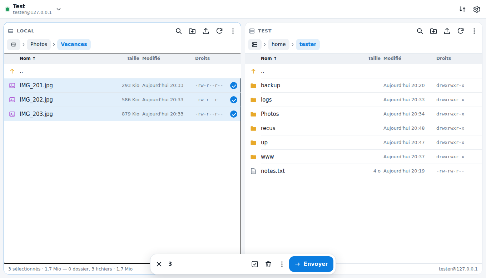
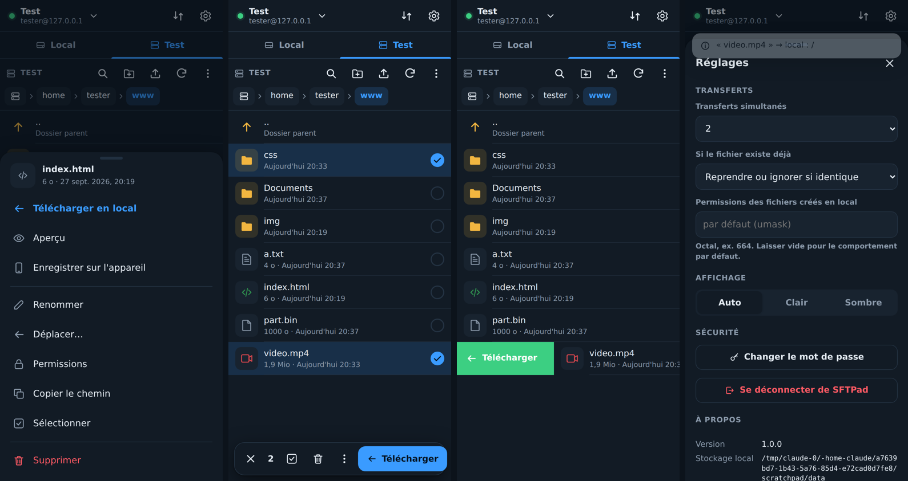

# SFTPad

🇬🇧 English · [🇫🇷 Français](README.fr.md)

A **touch-friendly, installable (PWA) web SFTP client** inspired by FileZilla, for personal use. It runs on a server
(Docker on Unraid, a Proxmox LXC, or any Docker host): the "local" side is the **storage mounted** into the container
(NAS, disk, shares), and the "remote" side is your SFTP server. Transfers are carried out **by the server**: they keep going
even if you close the tab or lock your phone.




## Features

- **Dual pane** local / remote on large screens, **tabs** on mobile.
- **Touch gestures**: tap to open, **long press** to select, **swipe right** to transfer,
  **swipe left** for the actions menu, drag the sheet down to close it, Android "back" button.
- **Mouse and keyboard**: click, Ctrl/Shift+click, double-click (open / transfer), right-click, **drag and drop**
  between panes, into a folder, or from the computer's desktop, shortcuts `Del`, `F2`, `F5`, `Enter`,
  `Backspace`, `Ctrl+A`, arrow keys, `Tab` to switch panes.
- **Persistent transfer queue** (`/config/queue.json`): recursive folders, adjustable concurrent transfers,
  pause, cancel, retry, **resuming of partial files**, **automatic retry** on network
  interruption, modification dates preserved, duplicate prevention.
- **If the file exists**: resume or skip if identical (default), overwrite, overwrite if newer, skip, rename.
- **Site manager**: password or **SSH key** (import, paste, or **ed25519 generation** with the public key
  ready to copy), default folders, color. Secrets are **AES-256-GCM encrypted** at rest.
- **Host key verification** like FileZilla: SHA256 fingerprint to approve on first connection,
  warning if it changes.
- **From / to the device**: upload files or folders from your phone or computer (to the local side
  or straight to the server), download to the device, **preview** of images, videos (with seeking),
  audio, PDFs and text files.
- Rename, move, delete (recursive), create folder, **permissions (chmod)**, filter, sort, hidden files,
  light / dark / auto theme.
- Interface in **French and English**: follows the browser language by default, can be changed under **Settings → Language**.
- Built-in authentication (scrypt-hashed password, 30-day sessions, brute-force protection), or delegated
  to your reverse proxy (`AUTH=none`).

## Installation

### Unraid (Docker)

The image is published automatically to GitHub Container Registry: **`ghcr.io/yogui26/sftpad:latest`** (amd64 and arm64),
rebuilt on every change to the `main` branch (workflow `.github/workflows/docker.yml`).

1. In the Unraid terminal, fetch the template:
   ```bash
   wget -O /boot/config/plugins/dockerMan/templates-user/my-SFTPad.xml \
     https://raw.githubusercontent.com/Yogui26/sftpad/main/deploy/unraid/sftpad.xml
   ```
2. Go to **Docker → Add Container**, pick the **SFTPad** template, check the paths, then **Apply**.

| Setting | Container | Default | Purpose |
|---|---|---|---|
| Web interface | `8080` | `8080` | Web port |
| Configuration | `/config` | `/mnt/user/appdata/sftpad` | Sites, encrypted secrets, queue |
| Local storage | `/data` | `/mnt/user` | What SFTPad sees as "local" |
| PUID / PGID | | `99` / `100` | Owner of written files (nobody:users) |
| UMASK | | `000` | Permissions of created files |

Updates then show up in Unraid's Docker tab, as with any other container.

You can still build the image yourself: run `docker build -t sftpad:latest .` in this folder, then replace
the template's repository with `sftpad:latest`.

### Any Docker host (docker compose)

```bash
docker compose up -d --build
```

Adjust `docker-compose.yml`: the `/data` volume and `PUID`/`PGID` (the owner you want for downloaded files).

### Proxmox — LXC without Docker

On the Proxmox host, from this folder:

```bash
DATA_HOST_PATH=/tank/share bash deploy/proxmox/create-lxc.sh
```

The script downloads the Debian 12 template, creates an **unprivileged** container (512 MB RAM, 4 GB disk, start on boot),
mounts `DATA_HOST_PATH` on `/data`, installs Node.js 22 and SFTPad as a **systemd service**, and prints the address.
Useful variables: `CTID`, `CT_HOSTNAME`, `STORAGE`, `BRIDGE`, `IP` (`dhcp` or `192.168.1.50/24,gw=192.168.1.1`),
`DISK`, `MEM`, `CORES`, `SFTPAD_UID`/`SFTPAD_GID`.

> **Permissions in an unprivileged container**: the container's `sftpad` user (uid 1000) maps to uid **101000**
> on the host. To let it write to the mounted folder: `chown -R 101000:101000 /tank/share`, or an ACL
> `setfacl -R -m u:101000:rwX,d:u:101000:rwX /tank/share`.

Updating: `CTID=105 bash deploy/proxmox/update-lxc.sh` from the new version of the sources.

In an existing Debian/Ubuntu LXC or VM, simply run `bash deploy/lxc/install.sh` as root from this folder
(the script is idempotent: run it again to update). Configuration: `/etc/sftpad.env`, data: `/var/lib/sftpad`.

Prefer Docker inside an LXC? Create an LXC with `nesting=1`, install Docker, then follow the docker compose section.

## Configuration (environment variables)

| Variable | Default | Description |
|---|---|---|
| `PORT` | `8080` | HTTP port |
| `CONFIG_DIR` | `/config` | Application state (back this up) |
| `DATA_DIR` | `/data` | Root of the "local" side |
| `ADMIN_PASSWORD` | | Enforced password (otherwise chosen on first launch) |
| `AUTH` | | `none` to disable built-in authentication (an authenticating reverse proxy is then mandatory) |
| `TRUST_PROXY` | private networks | Express `trust proxy` setting, for IP addresses behind a reverse proxy |
| `PUID` / `PGID` / `UMASK` | `99` / `100` / `002` | Docker only: user and mask for created files |

Settings that can be changed in the interface: concurrent transfers (1 to 10), behavior when the file exists, permissions of
files created locally, theme, language (per device).

## Remote access and HTTPS

To install the PWA on a phone, the browser requires **HTTPS** (except on `localhost`). Put SFTPad behind your reverse proxy
(Nginx Proxy Manager, SWAG, Traefik, Caddy…) with **WebSocket enabled** (path `/ws`, used for live progress). Caddy example:

```
sftp.mydomain.com {
    reverse_proxy 192.168.1.20:8080
}
```

For large uploads from the device, raise the proxy's maximum request body size (`client_max_body_size 0;` on Nginx).
Avoid exposing SFTPad directly to the Internet: it gives access to your files and your servers. A VPN (WireGuard, Tailscale)
or proxy-level authentication is recommended.

## Troubleshooting

**"Write denied" / `EACCES` when downloading to local**: SFTPad writes as the `PUID:PGID` user
(99:100 = `nobody:users` on Unraid). The root of `/mnt/user` is owned by `root`: you need to enter a
**share** before transferring. If a share also refuses writes (created by root), run
**Tools → New Permissions** on that share in Unraid, or fix `PUID`/`PGID`. The effective user
is shown under **Settings → About**.

## Versions and rollback

Every published image gets several tags:

| Tag | Example | Does it move? |
|---|---|---|
| `latest` | `ghcr.io/yogui26/sftpad:latest` | yes, always the newest |
| version | `:1.1.0` | no (published version) |
| minor version | `:1.1` | follows 1.1.x patch releases |
| commit | `:sha-af94d5c` | no |
| date | `:2026-10-25` | last image built that day |

**Rolling back to a previous version on Unraid**: Docker → SFTPad → **Edit** → **Repository** field, replace
`latest` with the tag you want (e.g. `ghcr.io/yogui26/sftpad:1.1.0`), then **Apply**. To go back to automatic
updates, put `latest` back. The list of available versions is at
https://github.com/Yogui26/sftpad/pkgs/container/sftpad (an untagged image can also be used by its
digest: `ghcr.io/yogui26/sftpad@sha256:…`).

Updates do not change the format of the files in `/config` without saying so in the release notes.
To be safe, back up `/mnt/user/appdata/sftpad` before a major update (Appdata Backup plugin).

Publishing a new version: change `version` in `package.json` and push to `main`; the image automatically
gets the matching tag (e.g. `1.2.0`), and GitHub Actions creates the git tag `v1.2.0` along with a
release listing the changes. The weekly rebuild reapplies system
patches under the same version tag (same code, up-to-date base); to pin an exact image, use
the `sha-…` tag or the `@sha256:…` digest.

## Backup

All state lives in `/config`: `sites.json` (encrypted secrets), `secret.key` (encryption key — **without it, saved passwords
are lost**), `config.json`, `queue.json`, `sessions.json`.

## Differences from FileZilla

- SFTP only (no FTP/FTPS).
- "Local" is the storage of the server SFTPad runs on, not the computer running the browser; the device remains reachable
  through direct upload and download.
- One site shown at a time (quick switching via the site manager), no multiple connection tabs.
- Folders cannot be downloaded directly to the device (transfer them to local, or download file by file).
- No in-place editing of remote files, no folder comparison or synchronization.
- Symbolic links in local storage are followed (handy for mount points, but they can point outside `/data`).

## Development

```bash
npm install
CONFIG_DIR=./config DATA_DIR=./data npm start   # http://localhost:8080
```

No build step: Node.js backend (Express 5, ssh2, ws), vanilla JavaScript interface (ES modules).

Translations: the French strings are the keys (`t('Annuler')`); their English equivalents live in
`public/js/i18n.js` (interface) and `server/i18n.js` (server error messages).

```
server/   index.js (API, auth, WebSocket) · sftp.js (connections, host keys) · transfers.js (queue) ·
          fastio.js (pipelined SFTP I/O with resume) · localfs.js (local storage) · crypto.js · store.js ·
          i18n.js (fr/en error messages)
public/   index.html · style.css · app.js · js/ (pane, queue, sites, ui, api, util, i18n) · sw.js · manifest
deploy/   docker/ · unraid/ · lxc/ · proxmox/
```

License: GPL-3.0-or-later.
